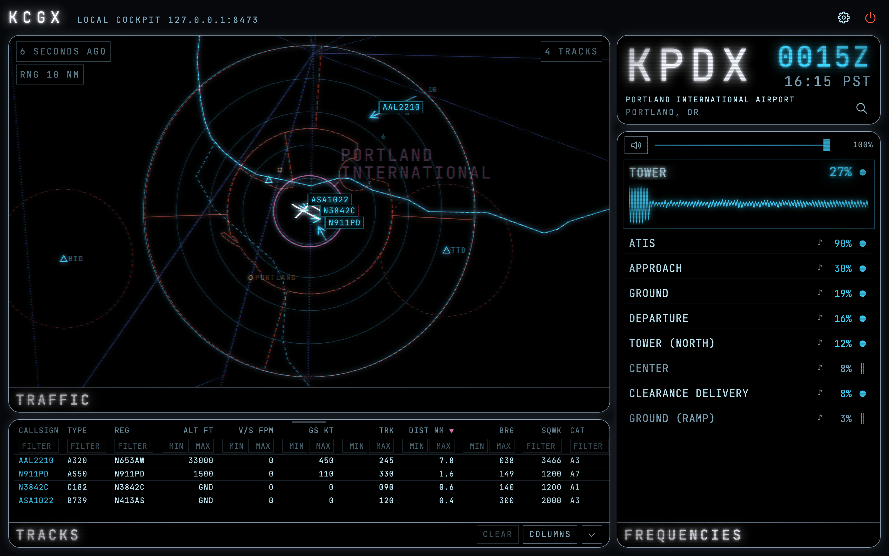

# kcgx


A cockpit for watching and listening to air traffic, in a window of its
own on a Mac or in your browser, named for Meigs Field — the Chicago
lakefront strip that a generation of flight-sim pilots took off from,
bulldozed in the middle of the night in 2003.



<sub>`kcgx --demo` at KPDX, the radar at 60 nm: synthetic traffic and
feeds, the cockpit's own radar, tracks table and frequencies.</sub>

It opens **every** ATC feed an airport publishes, one metered row each,
and plays the one you pick, beside its own vector radar of the traffic
around the field, on a page drawn like the NORAD wall in *WarGames*.
Everything runs on your own machine: a small local server plays the audio
and polls the radar, and the page at `http://127.0.0.1:8473/` is the
display and the controls.

```
kcgx              # start the cockpit if it is not running, and open it
kcgx go [query]   # switch airport, or open the page's airport search
kcgx stop         # shut it down
kcgx status       # is it running, and where
kcgx --browser    # open it in your browser, not in its own window
kcgx --demo       # the demo: synthetic feeds and traffic, no audio
```

[Install](#install) · [Running it](#running-it) · [The cockpit](#the-cockpit) ·
[The radar](#the-radar) · [Configuration](#configuration) ·
[Feed discovery](#feed-discovery-and-liveatcs-bot-protection) ·
[Buffering](#buffering) · [History](#history)

---

## Install

```bash
git clone https://github.com/mikElse/kcgx.git
cd kcgx
./setup.sh --check   # what you have and what you are missing; changes nothing
./setup.sh           # install the missing pieces, then open the cockpit
```

That is the whole install, on **macOS or Linux**, on any processor.
`setup.sh` works through seven steps, asks before it installs anything or
edits a file of yours, and finishes by starting the server and asking it
for the page and its live connection, to prove the cockpit will open. Step
5 alone makes things without a question of its own: the launcher's link,
and on a Mac the cockpit's window, both kcgx's own and both named as they
are made. It is idempotent, so the second run — the one you do when you
think something went wrong — ends where the first did.

### What it needs

| Tool | Why | Required? |
|---|---|---|
| [`uv`](https://docs.astral.sh/uv/) | runs everything, and supplies Python 3.14 itself | yes |
| [`ffmpeg`](https://ffmpeg.org/) | decodes each feed to PCM | yes |
| **PortAudio** | what `sounddevice` plays through | on Linux |
| a web browser | the cockpit is a page | yes |
| `swiftc` | builds KCGX.app, the cockpit's own window | no; macOS only |

`setup.sh` installs the first three: Homebrew on macOS, `apt`/`dnf`/`pacman`
on Linux. It never installs a package manager — if there is none it stops
and prints the packages instead. `swiftc` comes with the Xcode command line
tools (`xcode-select --install`), which Homebrew already needs; setup does
not install it, and without it the cockpit opens in your browser.

**PortAudio is the one that bites on Linux.** The `sounddevice` wheel bundles
its own copy on macOS and ships none on Linux, so without `libportaudio2`
(or `portaudio`, depending on the distro) `import sounddevice` raises
`OSError: PortAudio library not found` and nothing can be heard. That is a
system library `uv sync` knows nothing about, which is why it is a step of
its own rather than a line in `pyproject.toml`.

**There is no Python to install.** `uv` supplies the 3.14 the project
requires: no system Python is read, no virtualenv is yours to create, and
there is no `pip install` step. See [A note on `python`](#a-note-on-python).

### The seven steps

| | Step | Asks before |
|---|---|---|
| 1 | What you have | — |
| 2 | System packages — `ffmpeg`, PortAudio | running your package manager |
| 3 | `uv`, and the Python it supplies | fetching the installer |
| 4 | Python dependencies (`uv sync`) | downloading anything |
| 5 | The launcher on your `PATH`, and on macOS its window | appending to your shell profile |
| 6 | The LiveATC feed list | fetching it |
| 7 | Checking it works | — |

```bash
./setup.sh --check     # step 1 alone, then exit
./setup.sh --verify    # step 7 alone, against this machine
./setup.sh --yes       # take every default; for unattended installs
./setup.sh --help
```

**Step 5 builds the window on a Mac** (since 2026-11-12). After the link
and the `PATH` question it runs `macos/build.sh`, which compiles one Swift
file with `swiftc`, puts it in a bundle and signs it for this Mac alone:
`~/Applications/KCGX.app`, or wherever `KCGX_APP` says. It does not ask
first, as it does not ask before making the link; it builds beside the
destination and moves the app into place only once it is whole, and it
refuses a destination that is not a KCGX.app it built. The app keeps the
`PATH` it was built with, because a launch from the Dock has no shell.
With no `swiftc`, or a build that fails, setup says so and carries on, and
the cockpit opens in your browser. Linux is not offered a window. To build
it later, run `macos/build.sh`; to remove it, `rm -rf
~/Applications/KCGX.app`.

**Step 6 fills the feed cache** before the first start needs it. LiveATC
refuses roughly three requests in four, and a cold start that loses that
coin flip opens on a single feed — see
[when it opens on one feed](#when-it-opens-on-one-feed). Out here nobody is
waiting on a page, so it can retry twenty times instead of eight. It is not
fatal: the feed list is a week-long cache, not a dependency.

**Step 7 runs things rather than looking for files.** It runs `ffmpeg`,
imports `numpy`, `sounddevice`, `starlette`, `uvicorn` and `websockets`
through the project's own interpreter, starts the real server (as the
demo, on a free port) and asks it for its health, the page and the
WebSocket's first frame, counts audio output devices, and asks LiveATC and
adsb.lol for the exact thing the cockpit asks them for, insisting on a
`200` — "something answered" is not the same claim, and a `403` answers.
On a Mac it also has a `window` row: `ok` when KCGX.app is there and
`codesign --verify` passes, `none` when there is no app (not a warning:
the cockpit opens in your browser), and a warning when an app is there and
does not verify, since macOS will not start it.

Anything it cannot fix but you can live without — no audio device, an
unreachable feed host, `kcgx` not yet on your `PATH` — is a warning and the
cockpit still opens. Anything that means a broken page stops the run, with
the command that fixes it.

### About your shell profile

**`setup.sh` will offer to edit it, and will not do so without asking.**
Step 5 links `bin/kcgx` into `~/.local/bin`, and if that is not on your
`PATH` it offers this line:

```bash
export PATH="$HOME/.local/bin:$PATH"
```

It detects your shell (`zsh`, `bash`, `fish` — `fish` gets `fish_add_path`
instead), shows you the line, names the file, and asks. If you say yes it
backs the file up to `<profile>.kcgx-backup` first and marks what it added;
a second run recognises the marker and does not append again. If you say no
it carries on: the cockpit still starts as `<repo>/bin/kcgx`, just not as
plain `kcgx`. An unrecognised shell is told, not guessed at. `--yes` takes
this default along with all the others.

### Doing it by hand

```bash
# macOS
brew install ffmpeg
# Debian/Ubuntu — libportaudio2 is not optional, see above
sudo apt-get install ffmpeg libportaudio2
# Fedora (ffmpeg comes from RPM Fusion, not Fedora itself)
sudo dnf install ffmpeg portaudio
# Arch
sudo pacman -S --needed ffmpeg portaudio

curl -LsSf https://astral.sh/uv/install.sh | INSTALLER_NO_MODIFY_PATH=1 sh   # if you don't have uv

git clone https://github.com/mikElse/kcgx.git
cd kcgx
uv sync
mkdir -p ~/.local/bin && ln -s "$PWD/bin/kcgx" ~/.local/bin/kcgx
macos/build.sh   # macOS, optional: ~/Applications/KCGX.app, the cockpit's own window
```

`INSTALLER_NO_MODIFY_PATH=1` stops uv's installer appending to `~/.zshrc`,
`~/.bash_profile` *and* `~/.profile` without asking. Link `bin/kcgx`
rather than copying it: it finds the repo through the symlink.
`./setup.sh --verify` checks a hand-built install and changes nothing.

### A note on `python`

`uv sync` reads `.python-version` (3.14), downloads that interpreter if you
do not have it, creates `.venv/` in the repo, and installs the dependencies
into it. Every command goes through `uv run`, which uses that interpreter
and **finds the project from your working directory**, so run them from
the repo or pass `--project`:

```bash
uv run pytest                           # the test suite
uv run --project ~/src/kcgx kcgx-web    # the server in the foreground, from anywhere
```

`bin/kcgx` always passes `--project` at its own repo root, which is why
`kcgx` works from any directory.

If [pyenv](https://github.com/pyenv/pyenv) shims come first on your `PATH`,
bare `python` fails *inside this repo* (`pyenv: version '3.14' is not
installed`). That is expected and harmless — `uv run` ignores pyenv
entirely, and `setup.sh` says so rather than changing your `PATH`.

## Running it

```bash
kcgx                    # start it (or find the running one) and open its window
kcgx --no-open          # start it without opening anything
kcgx --browser          # open the page in your default browser instead
kcgx go KSEA            # switch airport: an exact ICAO
kcgx go seattle tacoma  # ...or any search that names one airport
kcgx go --open KSEA     # switch, and show the cockpit as well
kcgx go portland        # names several: opens the page's search with it typed
kcgx go                 # opens the page's airport search
kcgx status             # running at http://127.0.0.1:8473/  (KPDX)
kcgx stop               # stop the server, and the audio with it
kcgx --demo             # the demo: synthetic feeds and traffic, no audio
```

**Its own window** (since 2026-11-12). On a Mac where setup has built
KCGX.app, `kcgx` and `kcgx go` show the cockpit there, when they show it
at all: a small WebKit app with one window, in the Dock as KCGX, and not a
tab in Chrome. `kcgx go` with an airport it can settle on (an ICAO, or a
search that names one) switches the cockpit and opens nothing, so a hidden
window stays hidden; `kcgx go --open KSEA` switches and shows it. With no
airport, or a search that names several, `kcgx go` opens the page's search,
as above.

The launcher looks for the app at `~/Applications/KCGX.app` (`KCGX_APP`
names another place) and hands it the page with `open`. Where there is no app,
on Linux, with `--browser`, or with `KCGX_BROWSER=1` in the environment
(anything but empty or `0` counts), the page opens in your default browser
as it always did; it does the same, and says so, if `open` fails. Opening
KCGX from the Dock or Spotlight with nothing running starts the cockpit
and shows it.

**Closing is not quitting.** The window's red button hides it and the
audio plays on; the Dock icon or Cmd-Tab brings it back. Quit (Cmd-Q)
stops the cockpit, whichever way it was started, and so does the power
icon on the page. That is the one difference from a browser: closing a
tab, or the browser itself, never stopped the cockpit, and quitting the
window does.

**If the window misbehaves, `kcgx --browser` is the way back.** The
launcher only knows that `open` took the link, not that the window then
showed the cockpit. `rm -rf ~/Applications/KCGX.app` puts everything back
in the browser for good. When this was written the app had been built,
signed and tested through its links, and nobody had yet watched the window
do what this section says.

**The server runs in the background** and outlives the terminal you started
it from: close the window or the tab and the audio keeps playing; run
`kcgx` again and it shows the running cockpit rather than starting
another. It writes where it is to `~/.local/state/kcgx/server.json` and
logs to `server.log` beside it. "Running" means its health check answers,
never that the file exists, so a file left by a crash or a reboot is
replaced. The port is `8473` (`KCGX_PORT` changes it); if something that is
not kcgx has it, the server takes a free one and records that.

**Stopping**: `kcgx stop`, the power icon on the page (it asks first), or
Quit in the window. Each stops every feed and the server; the page says
COCKPIT SHUT DOWN.

**The demo** (`kcgx --demo`, or `kcgx-web --demo`) runs synthetic feeds that
meter, chatter, reconnect and park like real ones, a dozen aircraft on
fixed paths around whatever airport is open (fewer of them at a short
range), one of which squawks 7600 for a minute in every five, and two
more parked at the field from the start. No network, no `ffmpeg`, no
audio, and nothing is remembered. It is what the tests run against, and
a way to look at the page anywhere.

**`kcgx-web`** is the server itself, in the foreground: `kcgx-web [--port
8473] [--icao KPDX] [--demo]`, Ctrl-C to stop. `kcgx-web --refresh-feeds
[--icao KSEA]` fills the feed cache and exits.

The server listens on `127.0.0.1` only and refuses requests that name
another host or come from another site's page.

## The cockpit

**It boots with a drawing** (since 2026-11-13). The first cockpit page the
server shows after it starts plays the Vector Cockpit animation over the
whole window: the runway and the skyline drawn on, a takeoff and a turn,
the tower with KCGX on its face, and its lights, 21.7 s in all, in the
theme you last chose. The page connects and fills in underneath it, then
fades in over 0.6 s as the drawing fades out. Any key or click skips it
at once (Shift and the other modifier keys alone do not), and lands on a
cockpit already live. It plays once a launch: a reload, a second tab or
the window reopened does not play it again. BOOT ANIMATION in CONFIG
turns it off, and reduced motion in your system settings skips it. Until
the server's settings arrive (1.5 s at most) the page is black, rather
than drawn in the default theme first. It is the animation at the top of
this page.

The page is a wall of framed screens with their names along the bottom:

| Screen | Shows |
|---|---|
| TRAFFIC | the radar (see [The radar](#the-radar)) |
| the airport (it has no title) | the ICAO, Zulu and your local time, the airport's name and place, and a search icon, bottom right, that opens CHANGE AIRPORT |
| FREQUENCIES | every feed, the one you hear with a trace of its level, and the master mute and volume at the top; it runs the full height of the right column |
| TRACKS | the traffic table: the columns you choose, filtered and sorted as you like; drag its top edge to resize it, or fold it away |
| TELETYPE | the message log, typed out; **off until you turn it on** in CONFIG |

The clocks are 24-hour by default, Zulu and local both. CLOCKS in CONFIG
gives 12-hour local time (`3:07 PM`), seconds on both, and the zone's
name or not.

The airport search (CHANGE AIRPORT) is 840 px wide, or the window less
32 px, and keeps its height whatever it finds; the results scroll inside
it.

The page was tightened on 2026-11-12: less padding round everything, and
two parts that are shown only when asked for, both under PANES in CONFIG's SYSTEM tab.

The **lamp bar** (STATUS LAMPS) sits under the radar, at the radar's
width: one lamp per feed in its state colour (cyan live, amber
reconnecting, red orange offline, dark parked), then RADAR, SERVER and
AUDIO, then EMERG, which lights red orange with the code when an aircraft
in range squawks 7500, 7600 or 7700.

The **teletype** sits under FREQUENCIES, beside TRACKS. It collects its
lines while it is hidden, so turning it on shows what was said. Hiding it
does not hide an error: while it is off, an error from the page itself (a
failed airport search, a setting the server refused, a shut down that did
not go through) shows in the banner under the header for eight seconds.
The server's own notes (a feed list it could not fetch, an emergency
squawk) are not put in the banner: they wait in the teletype.

Under 1100 px wide the page is one column: radar, airport, frequencies,
lamps, tracks, teletype.

**Every action is a click.** There are no keyboard shortcuts and no labels
naming keys. The header has two icons: a gear, which opens CONFIG (see
[Configuration](#configuration)), and a power symbol, which shuts the
cockpit down after asking. Each has a tooltip and a name for a screen
reader. FEEDS and PALETTE left the header on 2026-11-12: every feed an
airport publishes opens at launch already, and the palette is THEME in
CONFIG. Tab, Enter, Space and Escape work as they do on any page.

**The feed stack plays one feed at a time** (since 2026-11-13). Every feed
the airport publishes is a row, and you hear one of them, like the
buttons of a radio. The feed you hear is the expanded row at the top: its
title, its chatter figure, a percentage (`27%`), and its state glyph, left
to right, over an oscilloscope trace of its level 60 px tall. Every other
feed is one compact line, and a click anywhere on it picks it: it becomes
the one you hear, and the one you heard goes quiet. A click on the feed
already playing does nothing. The M and S buttons, and the word CHATTER,
went on 2026-11-13. Every feed meters whether or not you hear it.

**The master mute and volume** are at the top of the pane, where the line
counting feeds used to be: a speaker button, crossed when muted, then
the volume slider and its figure. The mute silences the output and keeps
the feed you picked and the volume as they were. Neither is in CONFIG:
they are the audio's state, which the server keeps while it runs and
every tab shows alike. The volume starts at `master_volume` in
`squelch.toml`, and the cockpit starts unmuted.

**Titles leave out the airport** (since 2026-11-13). LiveATC names feeds
`KPDX Tower (Both)` or `Chicago Approach (10R/28C)`; the stack shows
`Tower (Both)` and `Approach (10R/28C)`. The airport's city and the start
of its name (`Chicago O'Hare`, `Seattle–Tacoma`) go in any case, and its
ICAO and IATA codes in capitals only, since many codes are words (`LAS`,
`SAN`); each only as whole words, wherever it is in the title. A centre
named for another city keeps it (`ZSE Seattle Center` at KPDX), and a
title that would be left empty stays whole. SHORT FEED NAMES, under
SYSTEM in CONFIG, turns it off.

The feed you hear sits at the top. Everything below is ordered by how
busy it has been over the last five minutes — the fraction of that window
spent above `activity_threshold_dbfs`. A new order is applied only once
it has held for fifteen seconds and the pointer has been off the stack
for two, because a row that moves while you reach for it picks the wrong
frequency. Picking a feed moves the rows at once.

**LiveATC streams seven feeds at once from one address.** Past that the
quietest feeds are parked (dark lamp, `‖`); pick a parked one and it
starts, and the quietest of the others gives up its place.

**The tracks table** (since 2026-11-13). COLUMNS, in its title bar, opens
a checklist of fifteen columns: callsign, type, registration, altitude,
vertical speed, ground speed, track, distance, bearing, squawk, the hex
code, the category, the age of the position, latitude and longitude. The default is the seven it always had.
The last column shown cannot be unchecked. Under the header is a row of
filters: a text column matches any part of what you type, in any case; a
number column takes a MIN and a MAX, either left empty (ALT reads `GND`
as 0, and an aircraft that does not report a figure is left out once a
bound is set). CLEAR empties them. Filters are this tab's alone and go
with a reload; they hide rows and never touch the radar.

Click a header to sort by it, and again to reverse it. The sort is a
setting, so every tab sorts alike, and it **shades the radar**: the
table's first row is drawn at full strength and on top, the last at
40 % (SHADE BY SORT's SOME; `sort_floor` in the file), and the rest in between, in
the order of the whole sort, filtered rows included. Sorted by a column
that is not shown, the title bar says so (`SORT GS KT ▼`). The header and the
filter row stay put while the table scrolls.

**Drag the top edge of TRACKS** to make it taller or shorter, from 10 % of
the page to 80 % (at least its header and two rows, and never so tall the
radar goes); the radar takes what is left. On the edge, the arrow keys
move it by 2 %, Page Up and Page Down by 10 %, and Escape during a drag
puts it back. The chevron in its title bar folds the pane to its title
bar, and the radar takes the room. Both are remembered. Under 1100 px
wide there is no edge to drag, and folding still works.

**The focused track leads the table.** Click an aircraft on the radar, or
its callsign in TRACKS, and its row moves to the top of the table, a fifth
larger in every cell, with the rest dimmed, whatever the filters say;
sorting orders the others beneath it. The radar goes to it and follows it
(see [The radar](#the-radar)). Click again and it goes back to its place.

**Every setting is remembered.** The theme, the glow, the display (off;
vector, with flicker and jitter; CRT, adding scanlines and rounded
screens) and everything else in CONFIG are kept by the server, so every
tab, the window and every start agree. Reduced motion in your system
settings turns off every animation, the boot's included.

## The radar

Our own vector renderer, not a map library: line art on black, an
azimuthal equidistant projection centred on the airport, so the range
rings are true circles and distance reads straight off the screen. The
range fits the shorter side of the screen; the longer side shows more map.

- **The range** is how far out traffic is asked for: 40 nm unless you
  change it, and from 10 to 250 nm under OPENING RANGE in CONFIG. 250
  is the most adsb.lol will answer for. The range's own ring is drawn
  bright. A new range resets the view to it.
- **The readouts** in the radar's top left corner are, since 2026-11-13,
  how long ago the radar was polled, in words (`5 SECONDS AGO`), and
  under it the range (`RNG 40 NM`). Top right is the number of aircraft
  drawn (`12 TRACKS`).
- **Aircraft** are chevrons along their track, each with a flight tag and
  a tail. Positions are dead reckoned between polls (AIRCRAFT MOTION
  GLIDE; STEP leaves each where it was last reported until the next
  poll), an aircraft fades after 30 s without a position and drops at
  `radar_stale_secs`, and one with no callsign is `UNK1`, `UNK2` in
  order of first sighting. An emergency squawk turns it red orange and
  adds one line to the teletype.
- **Tails** are where the aircraft has been in the last three
  minutes (LENGTH under TAILS, to ten; OFF draws none), so a
  tail is as long in time at any poll rate. They fade from the chevron
  back as before, and how bright they start goes by ground speed: 35 % under
  40 kt and 95 % at any other, or when the speed is not reported.
  SHADE BY SPEED off makes the slow as bright; the file has the five
  numbers (`tail_alpha_min`, `tail_gs_low` and the rest). Ten minutes of each aircraft's positions are kept whatever
  the setting, so a longer tail shows its history at once.
- **The flight tag** shows the fields chosen under FLIGHT TAG SHOWS in CONFIG:
  callsign, type, squawk, altitude, ground speed, track and distance. With
  two or fewer it is one line, and the default, callsign and altitude, is
  `ASA412 6200`. With more it is two: who it is over what it is doing,
  `ASA412 B39M 4512` over `3100 230KT 270° 11.0NM`. What an aircraft does
  not report is left out, and with no field chosen there is no tag, only
  the chevron. **Tags are drawn over everything** (since 2026-11-13): over
  the map, other aircraft and other tails, with a boxed tag's box first,
  so a line crossing a tag no longer brightens its letters. The tag
  ranked first by the table's sort is on top, and the focused one above
  all. TAG SIZE sets the size at the range's view (16 px).
- **Parked traffic fades** (since 2026-11-13). An aircraft is parked
  while its ground speed is under 5 kt (`ground_gs`) and it reports `GND`,
  or an altitude under `ground_alt` (0 ft unless you set it, so `GND`
  alone counts). After AFTER minutes (2) parked, it is drawn at 25 %
  (`ground_alpha`), chevron, tail and tag, under PARKED TRAFFIC's FADE; HIDE leaves
  it off the radar, and SHOW changes nothing. The altitude is above sea
  level, so at a high field leave BELOW ALTITUDE at 0. The server keeps
  the count, so every tab agrees and a reload does not restart it. The
  focused aircraft is never faded or hidden, and the table is not
  affected: its filters are for that.
- **Click an aircraft** (arrow, trail or tag) to focus it: it turns pink
  with a ring and the rest dim, and its row leads the TRACKS table.
  Since 2026-11-13 the radar also goes to it, 10 nm from it to the nearer
  edge (FOLLOW AT), and follows it. The wheel zooms about it and keeps
  following; a drag stops the following and keeps the focus. Click it
  again and the view goes back to where it was before (unless you have
  dragged it, or centred a place, since). Where a tag with a filled box lies over another
  aircraft's chevron, the click is the tag's: you click what you see.
- **The data box** sits beside the focused aircraft, to its left, or to
  its right and below it when the left would leave the radar: one line
  for each column the tracks table shows, in the table's order, name and
  value (`ALT FT: 6200`). It follows the aircraft, hides while the
  aircraft is off the screen, and is always on a box, at least 80 %
  black. DATA BOX in CONFIG turns it off.
- **Click a place** (an airport, a navaid, a city, a peak, a state's
  name, or the home ring) and the view eases to centre it, at the same
  zoom. Lines (coasts, airspace, airways) are not places.
- **Drag** to pan, **scroll** to zoom, **double click** to come back to
  the airport at the range (that also ends a follow). The closest view is
  0.25 nm from the centre to the nearer edge, close enough for the
  runways to fill the screen (2.5 nm until 2026-11-13); the widest is 160
  nm, or the range if that is more. ZOOM SPEED scales the wheel from a
  quarter to four times. Every move the radar makes for you (to a place,
  to an aircraft and back) eases over 250 ms, or 600 ms with VIEW MOVES
  at SMOOTH; OFF jumps. The title strip shows the pointer's bearing and
  distance from the field. (There was a RECENTRE button until
  2026-11-12.)
- **Range rings** follow the view: every 0.05, 0.1, 0.2, 0.5, 1, 2, 5,
  10, 20 or 50 nm, whichever puts no more than five between the centre
  and the nearer edge, out to the range, each numbered where its number
  has room. A number that would lie across the airport's name is left
  off.
- **Place names** sit back at about 40% and come up under the pointer.
  Labels never overlap: one that does not fit is left off, its symbol
  kept. Small airports appear from a 27 nm view inwards. Since
  2026-11-13 **labels grow as you zoom in and shrink as you zoom out**:
  each layer's LABEL size is its size at the range's view, and a view k
  times closer makes it k^0.35 times as big, held between 9 and
  26 px (LABEL SIZE's M). The airport's own name, at 30 px, is never
  made smaller than that at the range's view. Flight tags grow the same
  way from TAG SIZE.
- **Map layers** are styled on CONFIG's MAP tab and in `prefs.json`:
  for each of coasts, lakes, rivers, country and state borders, airways,
  class B, C and D airspace, runways, range rings, the home airport,
  other airports, navaids, cities, peaks and state names, whether it
  shows, its strength, its line (SOLID, DASH, DOT), its width and its
  label's size, as far as each has them. The defaults draw the map as it
  was.
- **Label boxes** put a black box behind the labels you choose under
  LABEL BOXES in CONFIG: flight tags, the home airport's name, other
  airports, navaids, cities, peaks, state names, ring numbers, and the
  readouts in the radar's corners. One fill, padding, border and border
  width serve them all (LABEL BOXES sets the fill and the border); the border takes the label's colour. None is
  boxed unless you choose it. A boxed label is never laid across another
  label of the map, so with boxes on a ring number or a place name that
  no longer fits is left off.

The map is coastlines, lakes and rivers, country borders (green, dashed)
and state lines, cities, peaks, VORs (diamonds), other airports
(triangles), the home airport's runways in white, its pink ring (2.5 nm
in radius, held between 24 and 64 px on screen so the name stays beside
it), and in the US the class B, C and D airspace (red orange, dashed) and
the Victor airways (blue, dashed). Close in, once a runway is wider on
the screen than its line, it is drawn solid at its true width, from
OurAirports (a runway it gives no width is drawn 150 ft wide).

**Where the traffic comes from.** The server polls
[adsb.lol](https://adsb.lol) for the range around the field every 15 s,
unless you set it longer, and sends the picture to every open tab, so two tabs do not double the rate.
Changing the range never causes a poll: the new range is asked for at the
next one that was due anyway, so a wider picture fills in up to 15 s
later, while a narrower one drops what is beyond it at once.
Fifteen seconds is deliberate: adsb.lol says its [rate limits are dynamic
based on the environment load](https://github.com/adsblol/api), and from
one address 2 s and 5 s polling drew a steady stream of `429`s that
persisted through slower intervals once tripped. RADAR UPDATES in CONFIG
(since 2026-11-13; `radar_refresh_secs` in `squelch.toml` until then)
lengthens the interval, 15 to 120 s in fives, and never shortens it
below 15 s; like the range, a new interval never causes a poll. A refused
poll keeps the last picture and backs off, doubling the interval each
time, to two minutes or four intervals, whichever is longer (at 15 s: 30,
60, then 120 s); the radar's corner says `ERR 429, PICTURE 45 SECONDS
OLD` and the RADAR lamp turns amber.

Each aircraft carries everything the table can show: since 2026-11-13
that includes adsb.lol's registration, vertical rate and category where
it sends them. All three are in its [API document](https://api.adsb.lol/api/openapi.json),
as optional fields; an aircraft that lacks one shows an empty cell. The
type's description and the operator were columns for a day, until the
document and a live reply (2026-11-14) showed adsb.lol sends neither.

adsb.lol refuses a request with no `User-Agent` (`403 User-Agent too
generic; include valid contact info.`), so the server sends
`kcgx/0.1 (+https://github.com/mikElse/kcgx)`. `KCGX_ADSB_UA` replaces it;
set it empty to send none. Put your own contact in if you fork this —
being reachable is what adsb.lol is asking for. (This was
`api.airplanes.live` until 2026-08-13, when it began refusing every
unauthenticated client.)

**The map is committed**, in `src/kcgx/data/geo.json.gz` (4.7 MB), so it
needs no network. The server sends each page the 320 nm around its airport
(200 until 2026-11-12), which leaves room to pan at the widest range.
All of it is public domain:

| Layer | Source |
|---|---|
| coastlines, lakes, rivers, borders, cities, peaks | [Natural Earth](https://www.naturalearthdata.com/) 10 m, v5.1.2 |
| navaids, airports, runways | [OurAirports](https://ourairports.com/data/) |
| class B, C and D airspace; Victor airways (US) | FAA [NASR 28 day subscription](https://www.faa.gov/air_traffic/flight_info/aeronav/Aero_Data/NASR_Subscription/) |

To rebuild it, download the FAA cycle's `class_airspace_shape_files.zip`
and `<DD_Mon_YYYY>_CSV.zip` into `.geo-sources/`, then:

```bash
uv run python tools/build_geodata.py
```

It fetches the rest itself into the same folder, and the same sources give
the same bytes. Without the FAA files the airspace and airway layers are
empty and it says so.

## Configuration

There are two places: CONFIG on the page, for the look, the radar, the
tracks table and the feeds' names, and a TOML file, for the audio engine
and the poller's staleness.

### CONFIG, on the page

The gear in the header opens CONFIG, which since 2026-11-14 is a panel
480 px wide down the right of the window. It does not cover the cockpit:
the page moves over, and the radar, the tracks and the frequencies lay
themselves out in what is left, all still in use. (From 2026-11-13 it
filled the window over a darkened page.) Where the page is one column, at
1100 px and under, the panel lies over it. It has four tabs, DISPLAY,
RADAR, MAP and SYSTEM; the arrow keys move between them, and it opens on
the tab you last used while the page is open. The gear again, the X or
Escape leaves it. A change goes to the server, which checks it, saves it
and tells every open page, so every tab and the window agree. The
settings live in `~/.local/state/kcgx/prefs.json`; a value there that is
not one its setting takes falls back to its own default and disturbs no
other. The demo never writes the file.

A setting that is not its default has an amber mark beside its name, and
its section a RESET, which puts that section back. RESET ALL at the foot
puts back every setting, those with no control in the panel too, but the
TRACKS pane's own (its columns, sort, height and fold).

The panel offers a few values for each number, where the file takes any
in its range: a value set by hand that is none of them is kept and drawn,
and lights none of the buttons.

| Tab: section | Row | Offers | Default | In `prefs.json` |
|---|---|---|---|---|
| DISPLAY: LOOK | THEME | WOPR, AMBER, MATRIX, MONO | WOPR | `palette` |
| | SCREEN | OFF, VECTOR, CRT | CRT | `display` |
| | SCANLINES (with CRT) | LIGHT 18, MED 34, HEAVY 55 % | MED | `scan_opacity`, 0 to 100 |
| | GLOW | OFF 0, LOW 33, MED 54, HIGH 75, all three alike | LOW | `glow_map`, `glow_traffic`, `glow_text`, 0 to 100 each |
| DISPLAY: TEXT | FONT | CLASSIC, B612 MONO, SHARE TECH MONO, IBM PLEX MONO, JETBRAINS MONO, VT323, SYSTEM | CLASSIC | `font` |
| | TEXT SIZE | S 11, M 13, L 15, XL 17 px | M | `font_px`, 10 to 20 |
| | PAGE ZOOM | 90, 100, 110, 125, 150 % | 100 | `ui_zoom`, 50 to 200 in fives |
| DISPLAY: START | BOOT ANIMATION | OFF, ON | ON | `boot_anim` |
| RADAR: VIEW | OPENING RANGE | 10, 20, 40, 80, 160, 250 nm | 40 | `range_nm`, 10 to 250 in tens |
| | VIEW MOVES | OFF, QUICK, SMOOTH | QUICK | `view_ease` |
| | ZOOM SPEED | SLOW 50, NORMAL 100, FAST 200 % | NORMAL | `zoom_speed`, 25 to 400 |
| RADAR: AIRCRAFT | FLIGHT TAG SHOWS | any of CALLSIGN, TYPE, SQWK, ALT, GS, TRK, DIST | CALLSIGN, ALT | `tag_fields` |
| | TAG SIZE | S 13, M 16, L 20 px | M | `tag_px`, 10 to 28 |
| | MOTION | GLIDE, STEP | GLIDE | `motion` |
| | SHADE BY SORT | OFF 100, SOME 40, STRONG 15 %: how dim the last of the tracks sort is drawn | SOME | `sort_floor`, 0 to 100 |
| RADAR: FOCUS | FOLLOW AT | 5, 10, 20 nm | 10 | `follow_nm`, 1 to 50 |
| | DATA BOX | OFF, ON | ON | `info_box` |
| RADAR: TAILS | LENGTH | OFF, 1, 3, 5, 10 min | 3 | `tail_secs`, 0 to 600 in fifteens |
| | SHADE BY SPEED | OFF 95, ON 35 %: a slow aircraft's tail | ON | `tail_alpha_min`, 0 to 100 |
| RADAR: PARKED | PARKED TRAFFIC | SHOW, FADE, HIDE | FADE | `ground_mode` |
| | AFTER (unless SHOW) | 1, 2, 5 min | 2 | `ground_min`, 0 to 30 |
| MAP: LABELS | LABEL SIZE | S 7 to 20, M 9 to 26, L 12 to 34 px | M | `label_min`, 6 to 20; `label_max`, 12 to 48 |
| | LABEL BOXES | OFF, OUTLINE, SOLID: the fill and the border, 0 and 0, 0 and 60, 70 and 50 % | SOLID | `box_fill`, `box_border`, 0 to 100 each |
| | BOX THESE (unless OFF) | any of AIRCRAFT, HOME, AIRPORTS, NAVAIDS, CITIES, PEAKS, STATES, RINGS, HUD | none | `box_items` |
| MAP: AVIATION, GEOGRAPHY | a row for each layer | below | the map as it was | `map` |
| SYSTEM: CLOCKS | 24 HOUR LOCAL | OFF, ON | ON | `clock_24h` |
| | SECONDS | OFF, ON | OFF | `clock_seconds` |
| | ZONE NAME | OFF, ON | ON | `clock_zone` |
| SYSTEM: PANES | STATUS LAMPS | OFF, ON | OFF | `lamps` |
| | TELETYPE | OFF, ON | OFF | `teletype` |
| | SHORT FEED NAMES | OFF, ON | ON | `short_names` |
| SYSTEM: PERFORMANCE | SHARPNESS | LOW, STD, HIGH | STD | `aa`: OFF, ON, SUPER |
| | FRAME RATE | 30, 60, MAX | 60 | `fps_max`, 15 to 120 |
| | BURN IN | OFF 0, SHORT 19, LONG 60 ms | SHORT | `burn_in`, 0 to 100 |
| | RADAR UPDATES | 15, 30, 60 s | 15 | `poll_secs`, 15 to 120 in fives |

These have no control in the panel since 2026-11-14, and keep what the
file says (or RESET ALL's defaults): `scan_size` (2 to 8 px, default 3),
`box_pad` (0 to 12 px, 4), `box_width` (1 to 5 px, 1), `tail_alpha` and
`tail_alpha_max` (0 to 100 %, 95 each), `tail_gs_low` and `tail_gs_high`
(0 to 600 kt, 40 and 250), `ground_gs` (0 to 50 kt, 5), `ground_alt` (0
to 5,000 ft in hundreds, 0) and `ground_alpha` (0 to 100 %, 25).

The TRACKS pane sets its own, not CONFIG: whether it is folded
(`tracks_open`, default `true`), its height (`tracks_pct`, 10 to 80 % of
the page, default 24), and from the COLUMNS checklist in its title bar
and a click on a header, `track_cols` (default CALLSIGN, TYPE, ALT, GS,
TRK, DIST, SQWK), `track_sort` (DIST) and `track_desc` (`false`).

**The map's layers** are under AVIATION and GEOGRAPHY, a row each: a box
to show it or not, and its weight, FAINT, NORMAL or BOLD. NORMAL is the
layer as the table below has it; FAINT is half its ALPHA; BOLD is half as
much again of its ALPHA (to 100) and WIDTH, and a quarter more of its
LABEL (to 32). In the file each layer has the cells that mean something
for it: `show`; `alpha`, 0 to 100 %, a share of the layer's own strength;
`line`, SOLID, DASH or DOT; `width`, 0.5 to 8 px in tenths (`18` is 1.8
px); `label`, 8 to 32 px, the label's size at the range's view. The panel
has no control for `line`; a layer set to none of the three weights
lights none, and its section's RESET puts the whole row back.

| Row | ALPHA | LINE | WIDTH | LABEL |
|---|---|---|---|---|
| COAST | 100 | SOLID | 1.8 | |
| LAKE | 75 | SOLID | 1.2 | |
| RIVER | 50 | SOLID | 1.0 | |
| COUNTRY | 90 | DASH | 1.2 | |
| STATE | 55 | SOLID | 1.0 | |
| AIRWAY | 70 | DASH | 1.2 | |
| CLASS_B, CLASS_C | 90, 80 | DASH | 1.4, 1.3 | |
| CLASS_D | 45 | DOT | 1.0 | |
| RUNWAYS | 100 | | 1.6 | |
| RINGS | 35 | SOLID | 1.0 | 12 |
| HOME | 100 | | 1.8 | 30 |
| AIRPORTS, NAVAIDS, CITIES, PEAKS | 85 | | 1.3 | 13 |
| STATE_NAMES | 100 | | | 14 |

Some of the rest, explained:

- **PAGE ZOOM** scales the whole page, CONFIG included, as a browser's zoom
  would; the radar stays as sharp. KCGX.app has a zoom of its own, which
  is not used. **TEXT SIZE** is the base size of the small text (the
  tracks table, the buttons, the airport's name); titles, big figures and
  the radar's labels keep theirs. **FONT** CLASSIC is the pair the
  cockpit always had, B612 Mono for text and Share Tech Mono for titles
  and the radar; each of the others is used for everything. All of them
  are monospaced, OFL, and served from the cockpit itself, never fetched.
- **GLOW** is three numbers in the file since 2026-11-13, for the map,
  the traffic (aircraft, tails, tags and the feeds' traces) and the
  page's text, which the panel sets alike; 33 is the old LOW and 75 the
  old FULL. A `prefs.json` from before keeps
  its look: its `glow` (OFF, LOW or FULL) is read as 0, 33 or 75 in all
  three.
- **SHARPNESS** is the radar's and the traces' resolution: LOW draws
  them at half the display's and scales them up stepped; STD at the
  display's own; HIGH at twice it and lets the browser scale it down,
  smoother and four times the pixels. No canvas is given more than 8
  million pixels, so HIGH on a large Retina window is a little less than
  twice.
- **BURN IN** is how long the moving traffic's afterglow takes to fade
  to half, with SCREEN at VECTOR or CRT: 19 ms is how it looked before
  at 60 frames a second, and it looks the same at any frame rate. 0 leaves
  none.
- **FRAME RATE** caps every animation on the page, the boot's
  included; MAX, 120 in the file, means the display's own rate, whatever it is.

SCANLINES works only with SCREEN at CRT, and is greyed otherwise; the
dark line is a third of `scan_size`. A hand-edited value off its
setting's step (a range of 45) falls back to the default. In the file, ON and OFF are `true` and `false`,
numbers are whole, the lists are JSON lists, and `map` is an object of
rows, each an object of its cells. The sheet used to end with LIMITS,
which showed the stream limit and changed nothing; it went on
2026-11-12.

### `squelch.toml`

kcgx reads TOML from `~/.config/squelch/squelch.toml` (the name is the
audio engine's, from before the cockpit had a page). **Nothing creates it
for you**:

```bash
mkdir -p ~/.config/squelch
$EDITOR ~/.config/squelch/squelch.toml
```

Every key is optional. Unknown keys are ignored, so an older version can
read a newer file; known keys are type-checked at start, and a bad value
stops the server with a message naming the file and the key.

| Key | Default | Meaning |
|---|---|---|
| `icao` | `"KPDX"` | The airport to open when none has been chosen yet |
| `feed` | `"kpdx3_twr"` | The one feed heard at start |
| `activity_threshold_dbfs` | `-40.0` | Level above which a feed counts as busy for the five-minute ranking. A decimal (`-40.0`, not `-40`). |
| `master_volume` | `1.0` | Output gain at start, 0.0 to 1.0; the slider at the top of FREQUENCIES changes it while running |
| `buffer_seconds` | `4.0` | How far behind live a feed may fall before it drops audio; see [Buffering](#buffering) |
| `max_streams` | `7` | Streams held open at once; LiveATC's limit |
| `radar_stale_secs` | `60` | An aircraft not heard from for this long drops off |

**`radar_range_nm` was retired on 2026-11-12.** The range is CONFIG's
RANGE now, changed while running and remembered with the other settings.
A file that still sets the key loads as before; the key is ignored, as any
unknown key is.

**`radar_refresh_secs` was retired on 2026-11-13.** The poll interval is
the `poll_secs` setting now, CONFIG > GENERAL > RADAR POLL, changed while
running and remembered with the other settings. A file that still sets the
key loads as before; the key is ignored.

The airport you choose is remembered in `~/.local/state/kcgx/airport`, and
the cockpit reopens there; `icao` is only the fallback. `ambient_enabled`
and `ambient_gain_db` are still read, for the mixer's ambient bus, which
the page has no control for.

## Feed discovery and LiveATC's bot protection

LiveATC fronts its airport listing page with Cloudflare bot protection.
Measured against the live site: a browser `User-Agent` does not help,
spacing requests out does not help, and roughly **one request in four is
allowed through anyway**. (The `/play/*.pls` endpoints the audio comes from
are not protected, which is why audio works regardless.)

kcgx therefore treats a 403 on the listing as a coin flip to re-flip, not
an answer, and caches the result for a week under `~/.cache/squelch/`. **A
normal start makes no request at all.** The retry budget depends on what a
failure costs:

| | Attempts | Failure rate | Because |
|---|---|---|---|
| Start, cache present | 5 | ~24% | costs a week-old list |
| Start, no cache | 8 | ~10% | costs an empty or one-feed stack |
| `kcgx-web --refresh-feeds` | 20 | ~0.3% | costs a wall clock nobody is watching |

When a refresh is due and every attempt is refused, it falls back to the
cached list, and only opens the single configured feed if there is no cache
at all. Each fallback says so in the teletype.

### When it opens on one feed

On a **first** start at an airport there is no cache, so a run of refusals
leaves nothing to open but `feed` from the config. At the default airport
that is `kpdx3_twr`, so the stack comes up showing KPDX Tower and nothing
else, as though that were all LiveATC had:

```
KPDX — could not reach LiveATC's listing (HTTP Error 403: Forbidden);
opening kpdx3_twr only; choose the airport again to retry
```

That line is a note in the teletype, which is off unless you turn it on
in CONFIG; with it off, the only sign is a stack with one feed in it.

Choose the airport again: the search icon in the airport pane, then the
same airport, or `kcgx go KPDX`. With no cache to read it fetches the
listing afresh and opens every feed it finds. (Until 2026-11-12 a FEEDS
button did this; it went because it had no other use, every feed being
open already once the listing has been read.) Or fill the cache from
outside, as setup's step 6 does, and then choose the airport again:

```bash
uv run kcgx-web --refresh-feeds               # the remembered airport
uv run kcgx-web --refresh-feeds --icao KSEA   # any other
```

The cache is per ICAO, so a new airport is a cold one.

**kcgx never falls back to a different airport's audio.** The one-feed
fallback only fires when the configured feed's ident starts with the
airport's ICAO, so switching to KORD and losing the listing gives you an
empty stack with a message rather than Portland tower under a KORD header.

## What it does, and does not, do

- Opens every feed the airport publishes, each with its own `ffmpeg`
  process and ring buffer, into one stereo output.
- Starts with everything muted except the configured feed, and keeps it
  to one: you see the whole field at once, but hear one frequency, the
  one you last picked.
- Isolates failures per feed: one that cannot resolve, or whose `ffmpeg`
  dies, goes offline on its own row and says why. The others keep going.
- Does **not** record, save, or redistribute any audio. Playback is local
  only, for personal listening, consistent with LiveATC.net's terms of use.
- Does **not** transcribe; see [History](#history).

## Cost

One `ffmpeg` process, one ring buffer, and one thread per feed — twelve of
each at KPDX, seven of them streaming — feeding **one** stereo output
stream. Bandwidth is roughly 16–32 kbps per feed; the CPU is mostly
`ffmpeg` decode plus one mixing callback every 16 ms. The server adds a
radar poll every 15 s (or RADAR POLL's interval) and about 15 KB/s of
levels to each open tab. The page draws at MAX FRAME RATE, 60 a second
unless you change it. Its radar redraws only what moves, and leaves out
aircraft, tails and tags that are off the screen; the map is drawn when
the airport, a setting or the window changes, and while you pan, zoom or
follow an aircraft the last drawing is moved, and drawn afresh once the
view stops (or has moved far enough to need it).

## Audio shaping

**There is none.** What reaches the device is the decoded feed scaled by
master volume, or silence while the master mute is on:

```
ffmpeg ─► ring buffer ─► sum ─► master volume ─► master mute ─► stereo
```

A per-feed noise gate and an upward compressor were **removed** on
2026-08-02. The gate never had anything to reject — LiveATC squelches at
the source, so 87% of blocks arrive at exactly −96 dBFS with a ~70 dB gap
up to speech — and a gain that moves continuously is the wrong thing to
have in the path when the complaint is choppy audio. A test asserts that a
mixer built from the shipped config returns output equal to input, sample
for sample.

## Buffering

This is the number that decides whether the audio sounds continuous, and it
is not obvious, so it is written down.

**LiveATC does not trickle.** 93% of `ffmpeg`'s reads arrive less than a
millisecond after the previous one, in bursts separated by gaps of up to
2.5 seconds, each carrying roughly 1.2 seconds of audio. The stream also
runs about 1.05× the device clock.

Each feed's ring buffer absorbs that. When a burst is larger than the
buffer, the *oldest* samples are dropped; the buffer then drains and pads
with silence until the next burst. So the capacity is a ceiling on **how far
behind live a feed may fall before it starts discarding audio**. Measured
against a live KPDX tower feed:

| `buffer_seconds` | audio kept | blocks reaching the device as silence | typical lag |
|---|---|---|---|
| 0.5 | 36% | 61% | 0.0 s |
| 2.0 | 90% | 6% | ~1.0 s |
| **4.0** | **95%** | **0.6%** | **~1.5 s** |
| 8.0 | 99% | 0% | ~5.0 s |

4 seconds is the knee: three times the typical burst, so overflow is rare,
while staying close enough to live to sit beside a radar showing the same
aircraft. Raise it on a lossy connection; expect dropouts below about 2.5.
`tests/test_mixer.py` replays a synthetic burst source matching the
measurement and fails if the capacity goes back under a burst.

## Known limitations

- Feeds are discovered once per airport and the list is kept for a week;
  a feed that appears on LiveATC later shows up when the list is next
  fetched (`kcgx-web --refresh-feeds` does it now) and the airport is
  chosen again or the cockpit restarted.
- Flight tags are not placed around one another. Where aircraft are close
  their tags overlap, more so with every field chosen, and a boxed tag
  hides the one under it. At 250 nm a busy picture will be crowded.
- STATES under LABEL BOXES has nothing to box: the map that ships names
  no states.
- adsb.lol's API document (read 2026-11-14) gives a quota for the
  `/v2/` paths: 500 requests a day for an address with no key, 1,000
  with a free key and 7,200 for a feeder. Polling every 15 s is 5,760 a
  day, so an unkeyed install that runs all day may be over it; a refusal
  shows as `ERR 429` and backs off as above. KCGX sends no key. Whether
  adsb.lol enforces the figure has not been seen: a live reply that day
  carried no quota headers.
- Parked traffic is judged by an altitude above sea level, as the
  airport list has no field elevations: at a high field keep BELOW
  ALTITUDE at 0, where only `GND` counts.
- The tracks table's filters do not reach the radar, and are forgotten
  on a reload.
- Nothing in the round of 2026-11-13 (the boot, one feed at a time, the
  tracks table's new parts, the radar's new behaviour) has yet been
  looked at by a person against real feeds and real traffic, or in
  KCGX.app.
- The window is macOS only.
- All feeds share one output device.
- Ranking is by level, not speech detection: a feed with a noisy carrier
  ranks above a quiet but busy one.
- Outside the US the map has no airspace and no airways.
- Natural Earth's towns are sparse: Portland, Vancouver, Salem and Longview,
  but not Gresham.
- The page is for one person on one machine: the server listens on
  `127.0.0.1` only, and has no accounts.

## Development

```bash
uv run pytest -q                                   # the suite
uv sync --group dev --group browser                # once, for the page's own tests
uv run playwright install chromium webkit          # once
```

`tests/test_page.py` drives the page in a real browser, and runs each of
its tests twice: in Chromium and in WebKit, Safari's engine and the one
KCGX.app shows the page in. So do the files beside it from 2026-11-13,
one for each part of that round (`test_page_audio.py`, `_tracks`,
`_chrome`, `_map`, `_traffic`, `_seams` and `test_boot.py`), which share
their fixtures through `tests/page_fixtures.py`. Without the browser
group they skip; without one of the two browsers, that browser's half
skips. With both, the suite is about 2,150 tests and takes about 26
minutes:

```bash
uv run --group browser pytest -q
```

`tests/test_page_prefs.py` needs no browser: it holds the CONFIG sheet's
controls to `kcgx.prefs.SCHEMA`, the one description of every setting.
`tests/test_window.py` builds the real KCGX.app into the test's own folder
(on a Mac with `swiftc`; elsewhere that part skips) and asks its program,
with `--check`, what each of some forty links would show, and with
`--answers`, whether what is on a port says it is kcgx. Nothing in the
suite opens a window: what the window does once it is open has no test.
Nothing in it starts the real cockpit either: every server is the demo.
GitHub Actions runs the browserless part of the suite on macOS and Linux
for every push and pull request (`.github/workflows/tests.yml`).

## History

The cockpit began in a terminal: `squelch`, a Textual audio player in a
48-column pane, beside [`adsb-tui`](https://github.com/j4v3l/ADS-B_TUI) for
the radar and a status pane, arranged by a tmux script. It moved to the
browser in five phases in October 2026; the last one removed tmux,
adsb-tui and the terminal UI. A sixth, on 2026-11-12, tightened the page, moved every
setting into CONFIG, took the radar's range to 250 nm and its zoom to
2.5, and gave the cockpit a window of its own on macOS. A seventh, on
2026-11-13, added the boot animation, CONFIG in four tabs with some forty
new settings, one feed at a time under a master mute, the tracks table's
columns, filters and sort, and a radar that styles its map by layer,
follows the focused aircraft and zooms in to the runways. The last
commit with the terminal cockpit is tagged `terminal-cockpit`:

```bash
git show terminal-cockpit:bin/kcgx
git checkout terminal-cockpit -- src/squelch/app.py   # to look, not to keep
```

Before that, squelch transcribed the audio live, using an ATC-fine-tuned
Whisper model
([`jacktol/whisper-medium.en-fine-tuned-for-ATC-faster-whisper`](https://huggingface.co/jacktol/whisper-medium.en-fine-tuned-for-ATC-faster-whisper))
with WebRTC VAD segmenting the audio into whole transmissions. That was
removed: it cost a 1.5 GB first-run download that blocked audio startup,
and CPU-bound inference running for the life of the session. It is tagged
`squelch-with-transcription`:

```bash
git show squelch-with-transcription:src/squelch/asr.py
```

## License

kcgx is released under the [MIT License](LICENSE). What it bundles or
draws on keeps its own terms:

- **Fonts** in `src/kcgx/web/static/fonts/` are under the SIL Open Font
  License; each family's licence sits beside it (`OFL-*.txt`).
- **The map** (`src/kcgx/data/geo.json.gz`) and **the airport list**
  (`src/kcgx/data/airports.csv`) are built from public domain sources:
  Natural Earth, OurAirports and the FAA.
- **Audio feeds** are LiveATC.net's: kcgx plays them locally and never
  records or redistributes them, and LiveATC.net's own terms of use apply.
  **Traffic** comes from [adsb.lol](https://adsb.lol/), under its own terms.
